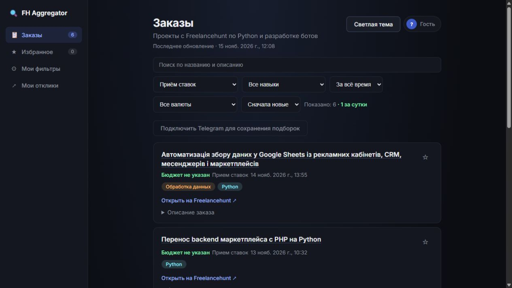
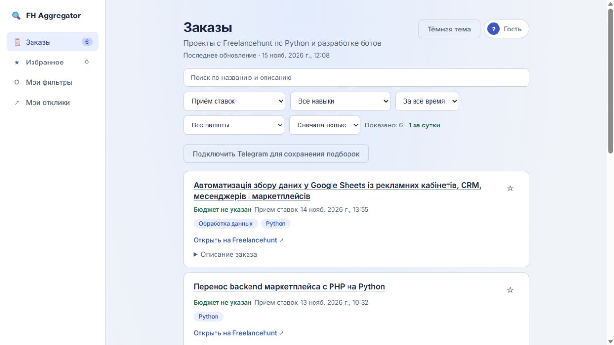

# Freelance Job Aggregator

Веб-приложение для поиска заказов на Freelancehunt и ведения откликов. Оно собирает проекты по Python и разработке ботов, уведомляет о совпадениях в Telegram и помогает подготовить отклик с примером работы из портфолио.

[Открыть демо](https://aggregator-wk8a.vercel.app/) · [Связаться на Freelancehunt](https://freelancehunt.com/freelancer/Pybackendev.html)

## Что можно сделать

- Найти проект по названию или описанию, отфильтровать по навыку, статусу, дате и бюджету, сохранить в избранное или открыть оригинал на Freelancehunt.
- Сохранить подборку из ленты, исключить заказчика или тему и получать уведомления в Telegram сразу или в ежедневной сводке. Тихие часы настраиваются по Киеву.
- Подготовить отклик на украинском, русском или английском, приложить кейс, сохранить цену и срок. После ручной отправки можно отметить статус и настроить напоминание.

Ленту можно открыть сразу. Для сохранённых подборок, уведомлений и истории откликов подключите Telegram в интерфейсе.

## Интерфейс

**Тёмная тема**

**Светлая тема**

## Технологии

Python, FastAPI, PostgreSQL, SQLAlchemy, Alembic, React, Vite, Docker и Telegram Bot API. Фронтенд развёрнут на Vercel, API и база работают на Render.
